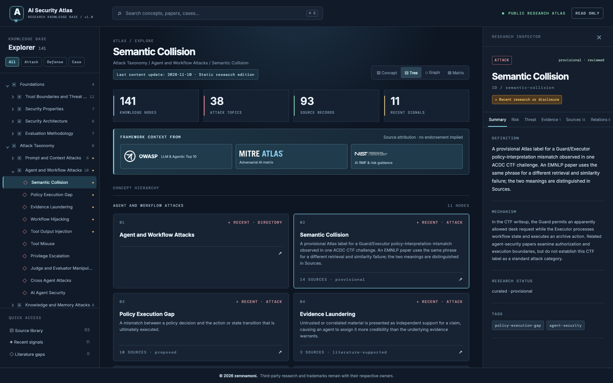

# AI Security Atlas

A public, read-only atlas for exploring AI security concepts, attacks, defenses, and the research behind them.

**[Explore the live Atlas](https://gogooma125732.github.io/Atlas/)**

## What you can explore

- **Concept dossiers:** definitions, risks, threats, evidence, sources, and relationships in one place.
- **Research library:** search papers separately from OWASP, MITRE, NIST, and vulnerability records.
- **Graph and matrix views:** trace links between concepts, evidence, sources, frameworks, attacks, and defenses.
- **Recent signals:** find newly published research and disclosures across the taxonomy, with a stated 18-month window.
- **Fast navigation:** browse 141 taxonomy nodes, search the atlas, and follow citations to primary sources.

The bibliography is curated and is not exhaustive. Content was last updated **November 10, 2026**.

## Run locally

Open `index.html`, or run `python3 -m http.server 8000` in this directory. No build step is required.

## License

Original code and editorial content are MIT licensed. Third-party logos, trademarks, and cited materials are excluded; see [third-party notices](THIRD_PARTY_NOTICES.md).
